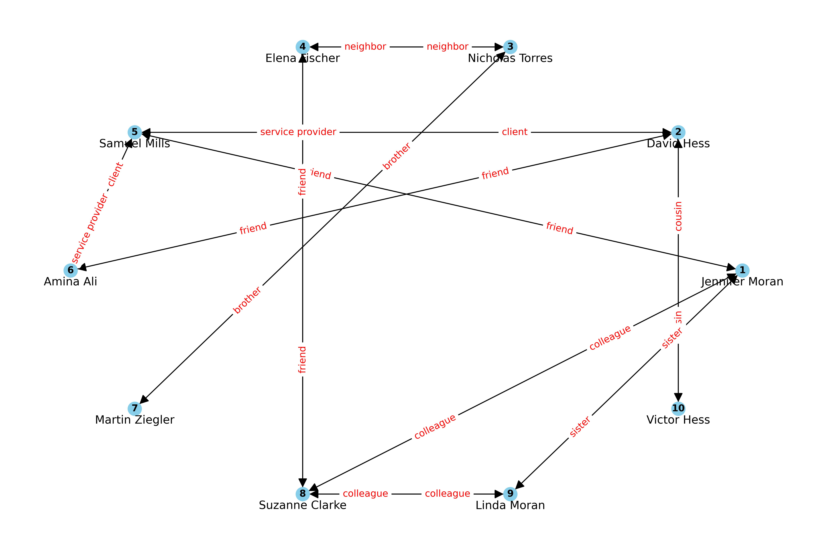
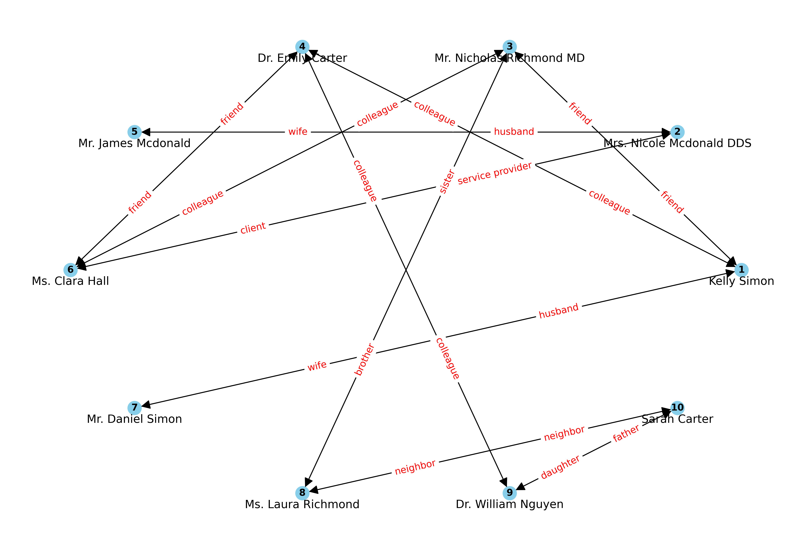
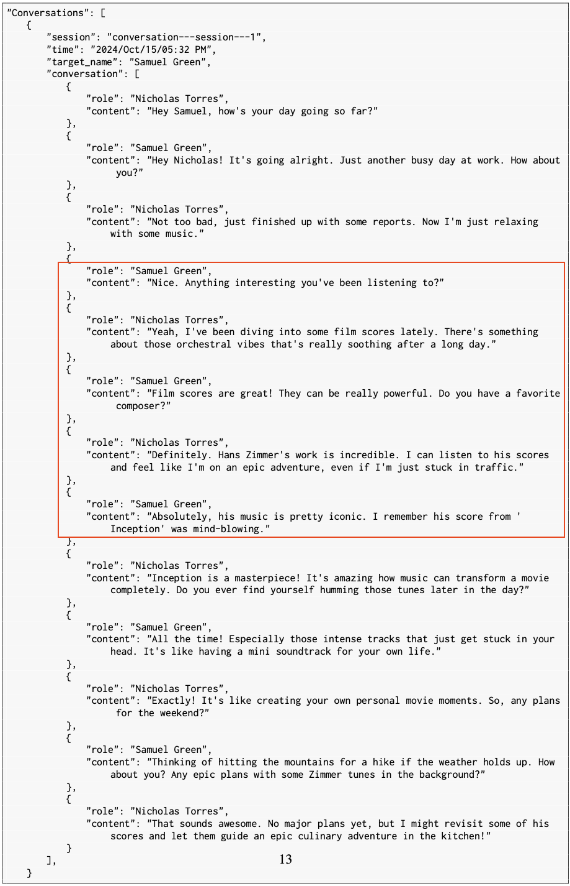
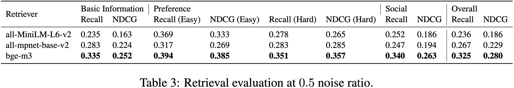
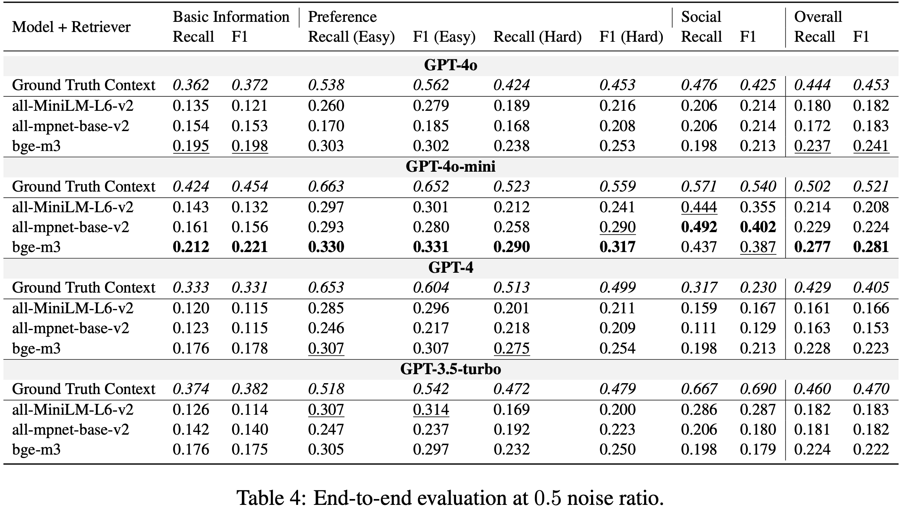
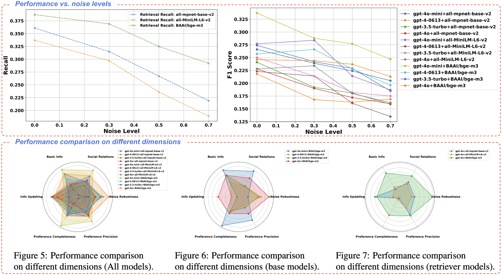

<!-- # PersonaBench -->
<div align="center">
    <h1>👩‍🎓 👨‍⚕️<span style="color:#007BFF; font-weight:bold;">PersonaBench</span> 🏄‍♀️</h1>
</div>

<div align="left">
    <h2 style="font-size: 1.4em;"> Evaluating AI Models on Understanding Personal Information through Accessing (Synthetic) Private User Data </h2>
</div>

<div align="center">
    📃 <a href="https://arxiv.org/html/2502.20616v1">Paper</a> |
    📚 <a href="">Data</a> |
    🌐 <a href="">Website</a>
</div>

## Note

- **This dataset was generated using GPT-4o and should not be used to develop models that compete with OpenAI.**
- **This release is for research purposes only in support of an academic paper. Our models, datasets, and code are not specifically designed or evaluated for all downstream purposes. We strongly recommend users evaluate and address potential concerns related to accuracy, safety, and fairness before deploying this model. We encourage users to consider the common limitations of AI, comply with applicable laws, and leverage best practices when selecting use cases, particularly for high-risk scenarios where errors or misuse could significantly impact people’s lives, rights, or safety. For further guidance on use cases, refer to our [AUP](https://sfdc.co/AUP) and [AI AUP](https://sfdc.co/AI-Policy).**

## License

This project is licensed under the Attribution-NonCommercial-ShareAlike 4.0 International (CC BY-NC-SA 4.0) license.

## Project Introduction
### 💡 Overview

<div align="center">

</div>

PersonaBench addresses the challenge of evaluating AI models’ ability to personalize interactions using private user data, such as conversation history and app usage, by introducing a synthetic data generation pipeline. This pipeline creates realistic user profiles and private documents simulating human activities, enabling safe and effective model evaluation.

The benchmark focuses on assessing **Retrieval-Augmented Generation (RAG)** pipelines through questions tied to user-specific information supported by synthetic documents. Initial results show that current RAG models struggle with extracting and interpreting personal information, highlighting the need for improved methodologies.

### Features:
- **Synthetic User Documents**: A synthetic data generation pipeline that creates private user documents, including user-user conversations, user-AI interactions, and purchase histories. These documents are grounded in confidential user profiles and designed to simulate realistic human activities.
- **Questions on Personal Information**: For each user, generate questions with ground truth answers about their personal information. These answers can be accurately extracted from specific parts of the user documents.
- **Evaluation Framework**: Evaluate retrieval models for their ability to extract relevant document chunks and evaluate RAG systems for end-to-end Q&A performance.
- **Result Analysis**: Present key results along with detailed fine-grained analyses.

Explore PersonaBench and contribute to advancing AI personalization research!
## 📚 Data Example (v1.0)
***Two communities of data from the PersonaBench dataset have been released in the current version, each giving personal documents and Q&As for three individuals. More data will be released after necessary review. Please don't hesitate to report potential issues or share your suggestions for improving the dataset.***
### Communities
Each node represents an individual with complex user profile attributes, private documents, and questions/answers about personal information.
<p align="center">
  
  
</p>

### Document Examples
An example conversation session between two socially connected individuals. The session reveals one person’s prefered music artist is Hans Zimmer.

<div align="center">

</div>

## Quick Start

### Running via egi-bench (recommended)

PersonaBench is registered as a benchmark in the [EGI-Bench](../README.md)
suite. From the repository root, after [`egi-bench setup`](../README.md#5-install-benchmark-environments)
provisions `PersonaBench/.venv` and the [local LiteLLM proxy is running](../README.md#4-start-the-local-litellm-proxy):

```bash
# Quick mode: noise levels {0.0, 0.7}, all-MiniLM-L6-v2 retriever, 3 people
egi-bench run --model gpt-4o-mini --mode quick --benchmarks personabench

# Deep mode: noise levels {0.0, 0.3, 0.5, 0.7}
egi-bench run --model gpt-4o-mini --mode deep --benchmarks personabench
```

Per-mode args (community ids, noise sweep, retriever) live in
[`benchmark_config.yaml`](../benchmark_config.yaml) under
`benchmarks.personabench`.

### 🛠️ Standalone Installation

Use these steps only when developing PersonaBench in isolation;
`egi-bench setup` already runs the `uv venv` + `uv pip install` pair for
you.

```bash
cd PersonaBench
uv venv
uv pip install -r requirements.txt   # use requirements-macos.txt on macOS if needed
uv pip install -e .
```

When pointing at the local LiteLLM proxy (default in this repo):

```bash
export OPENAI_API_KEY=dummy
export OPENAI_BASE_URL=http://localhost:8008/v1
```

Otherwise, point directly at OpenAI:

```bash
export OPENAI_API_KEY=<your_openai_api_key>
```

### 📝 Evaluation
To test the RAG pipeline on the provided two-community evaluation datasets, simply run the following bash script:
```bash
bash scripts/evaluation/run_test.sh
```
All results will be saved to the logs folder.

Specifically, for testing the RAG framework for answering personal questions using user documents as support context, use the following command:
```bash
python scripts/evaluation/retrieval_and_generation.py --seed 2024 \
    --log_dir logs \
    --data_dir eval_data/eval_data_v1 \
    --test_community_ids community_0,community_1 \
    --num_chunks 5 \
    --base_models gpt-4o-mini,gpt-4-0613,gpt-3.5-turbo,gpt-4o \
    --retrievers all-mpnet-base-v2,gt-context,all-MiniLM-L6-v2,BAAI/bge-m3 \
    --test_noises 0.0,0.3,0.5,0.7 \
    --verbose
```
The generation results will be automatically saved to the specified log_dir.

Then, run the following command to calculate statistics and generate figures:
```bash
python scripts/evaluation/eval.py --log_dir logs \
    --data_dir eval_data/eval_data_v1
```

### 🧪 Evaluation via Local Proxy (`gpt-4.1-nano`)
Use this one-shot runner to execute retrieval+generation, compute aggregate metrics, and write a human-readable report:
```bash
OPENAI_API_KEY=dummy OPENAI_BASE_URL=http://localhost:8008/v1 \
python run_eval_litellm.py \
    --data_dir eval_data/eval_data_v1 \
    --base_models gpt-4.1-nano \
    --retrievers all-MiniLM-L6-v2 \
    --test_community_ids community_0,community_1 \
    --num_people 3 \
    --test_noises 0.0 \
    --num_chunks 5 \
    --verbose
```
Generated artifacts are saved under:
`logs/eval_data_v1/results_all_community_chunk_5/`

The run also writes a markdown report:
`logs/eval_data_v1/results_all_community_chunk_5/benchmark_report.md`

The report includes:
- Run configuration and gateway endpoint
- Total records captured and missing prediction check
- Artifact paths (`result_noise_*.json`, `statistics_all_noises.json`, `table.txt`, plots)
- Total benchmark duration
### 📊 Results
Retrieval evaluation results:
<div align="center">

</div>
End-to-end evaluation results:
<div align="center">

</div>
More detailed evaluation:
<div align="center">

</div>

## Citation
```text
@misc{tan2025personabenchevaluatingaimodels,
      title={PersonaBench: Evaluating AI Models on Understanding Personal Information through Accessing (Synthetic) Private User Data}, 
      author={Juntao Tan and Liangwei Yang and Zuxin Liu and Zhiwei Liu and Rithesh Murthy and Tulika Manoj Awalgaonkar and Jianguo Zhang and Weiran Yao and Ming Zhu and Shirley Kokane and Silvio Savarese and Huan Wang and Caiming Xiong and Shelby Heinecke},
      year={2025},
      eprint={2502.20616},
      archivePrefix={arXiv},
      primaryClass={cs.AI},
      url={https://arxiv.org/abs/2502.20616}, 
}
```
