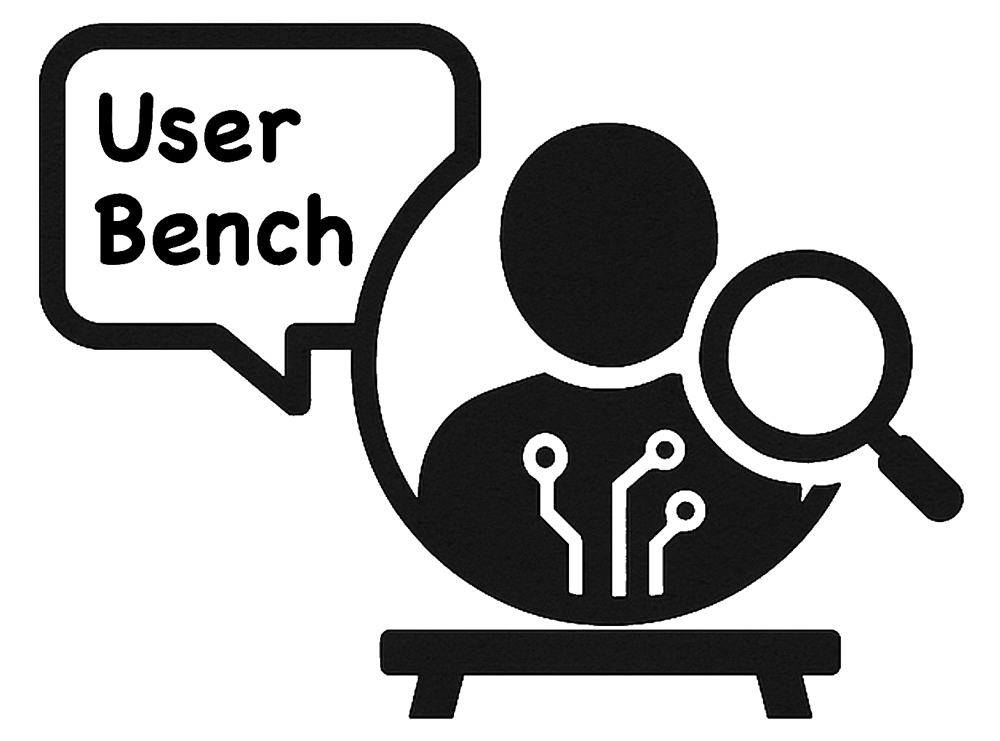
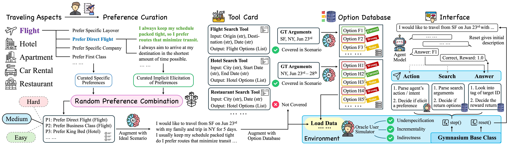

<p align="center">
  
</p>

# UserBench: An Interactive Gym Environment for User-Centric Agents

| [**📖 Paper**](https://arxiv.org/pdf/2507.22034) | [**📊 Dataset**](https://github.com/SalesforceAIResearch/UserBench/tree/main/travelgym/data) |

This is the official repository for paper "UserBench: An Interactive Gym Environment for User-Centric Agents".

UserBench is an evaluation environment for testing language models on multi-turn travel planning tasks. This open-source implementation provides a robust framework for evaluating how well language models can understand user preferences, make appropriate function calls, and provide personalized recommendations in travel planning scenarios.



## 🚀 Quick Start

### Running via egi-bench (recommended)

UserBench is registered as a benchmark in the [EGI-Bench](../README.md)
suite. From the repository root, after [`egi-bench setup`](../README.md#5-install-benchmark-environments)
provisions `UserBench/.venv` and the [local LiteLLM proxy is running](../README.md#4-start-the-local-litellm-proxy):

```bash
# Quick mode: travel22 / travel33 / travel44, capped at 60 tasks per env
egi-bench run --model gpt-4o-mini --mode quick --benchmarks userbench

# Deep mode: every env discovered in travelgym/data
egi-bench run --model gpt-4o-mini --mode deep --benchmarks userbench
```

Per-mode env list and `max_turns` / `pass_k` / `temperature` defaults live in
[`benchmark_config.yaml`](../benchmark_config.yaml) under
`benchmarks.userbench`.

### Standalone installation

Use these steps only when developing UserBench in isolation;
`egi-bench setup` already runs the `uv venv` + `uv pip install` pair for
you.

```bash
cd UserBench
uv venv
uv pip install -r requirements.txt
uv pip install -e .
```

### Standalone evaluation with the local LiteLLM proxy (`eval.py`)

Start the proxy first:

```bash
cd ../litellm_proxy
bash start_server.sh
```

Then run the full async evaluation:

```bash
cd ../UserBench
OPENAI_API_KEY=dummy OPENAI_BASE_URL=http://localhost:8008/v1 \
python eval.py \
    --model_name gpt-4.1-nano \
    --port 8008 \
    --max_turns 20 \
    --pass_k 1 \
    --temperature 0.0 \
    --envs travel22 travel33 travel44 \
    --save_name travel_gpt41nano_eval
```

Results are written to `outputs/results_<save_name>.json` and `outputs/reward_cache_<save_name>.json`.

### Full Async Evaluation with eval.py

The `eval.py` script is the main evaluation tool for TravelGym. It supports various model types:

#### 1. Evaluating OpenAI Models

```bash
python eval.py \
    --model_name gpt-4o \
    --port 8000 \
    --max_turns 20 \
    --pass_k 1 \
    --temperature 0.0 \
    --envs travel22 travel33 travel44 \
    --save_name travel_gpt4o_eval
```

#### 2. Evaluating Local Models with vLLM

First, start your vLLM server:

```bash
# Start vLLM server (example)
# Example:
vllm serve Qwen/Qwen3-8B \
   --max-model-len 32768 \
   --gpu-memory-utilization 0.9 \
   --tensor-parallel-size 4 \
   --enable-auto-tool-choice \
   --tool-call-parser hermes \
   --chat-template tool_template/hermes.jinja \
   --port 8000
```

Please make sure that tool call is enabled when serving the model.

Then evaluate:

```bash
python eval.py \
    --model_name Qwen/Qwen3-8B \
    --port 8000 \
    --max_turns 20 \
    --pass_k 1 \
    --temperature 0.0 \
    --envs travel22 travel33 travel44 \
    --save_name travel_llama2_eval
```

#### 3. Evaluating Other API Models

```bash
# Together AI API
python eval.py \
    --model_name deepseek-chat \
    --port 8000 \
    --max_turns 20 \
    --temperature 0.0 \
    --envs travel22 travel33 travel44 \
    --save_name travel_deepseek_eval

# Google Gemini
python eval.py \
    --model_name gemini-2.5-pro \
    --port 8000 \
    --max_turns 20 \
    --temperature 0.0 \
    --envs travel22 travel33 travel44 \
    --save_name travel_gemini_eval
```

Please note that the envs being evaluated could also be customized. Please refer to `travelgym/data` directory for more details.

### Configuration Options

| Parameter       | Description                         | Default                    |
| --------------- | ----------------------------------- | -------------------------- |
| `--model_name`  | Model name or path                  | Required                   |
| `--port`        | Port for vLLM server (local models) | 8000                       |
| `--max_turns`   | Maximum conversation turns          | 20                         |
| `--pass_k`      | Number of attempts per task         | 1                          |
| `--temperature` | Model temperature                   | 0.0                        |
| `--envs`        | Manual evaluation environments       | travel22 travel33 travel44 |
| `--save_name`   | Result file prefix                  | model_name                 |

## 🏗️ Architecture

TravelGym is built on the Gymnasium framework with the following key components:

### Core Environment (`travelgym/env/`)

- **`travel_env.py`**: Main environment with conversation and evaluation logic
- **`prompts.py` / `prompt_async.py`**: LLM prompts and response generation
- **`task_data.py`**: Dataset loading and management
- **`utils.py`**: Utility functions for evaluation

### Configuration (`travelgym/config.py`)

- Centralized configuration management
- Model-specific settings
- Environment parameters

### Evaluation Data (`travelgym/data/`)

- Structured scenarios with user preferences
- Ground truth annotations
- Multiple difficulty levels (travel22, travel33, travel44)

## 🔧 Advanced Usage

### Custom Evaluation Scripts

You can customize evaluation by modifying `eval.py` or creating your own scripts:

```python
import travelgym

# Create custom configuration
config = travelgym.TravelGymConfig(
    max_steps=15,
    temperature=0.2,
    data_mode="single",
    verbose=True
)

# Initialize environment
env = travelgym.TravelEnv(config)

# Run evaluation loop
observation, info = env.reset()
for step in range(config.max_steps):
    # Your model logic here
    action = your_model.generate(observation['feedback'])
    observation, reward, terminated, truncated, info = env.step(action)
    if terminated or truncated:
        break
```

## 🖊️ Citation

```text
@article{qian2025userbench,
  title={UserBench: An Interactive Gym Environment for User-Centric Agents},
  author={Qian, Cheng and Liu, Zuxin and Prabhakar, Akshara and Liu, Zhiwei and Zhang, Jianguo and Chen, Haolin and Ji, Heng and Yao, Weiran and Heinecke, Shelby and Savarese, Silvio and Xiong, Caiming and Wang, Huan},
  journal={arXiv preprint arXiv:2507.22034},
  year={2025}
}
```
