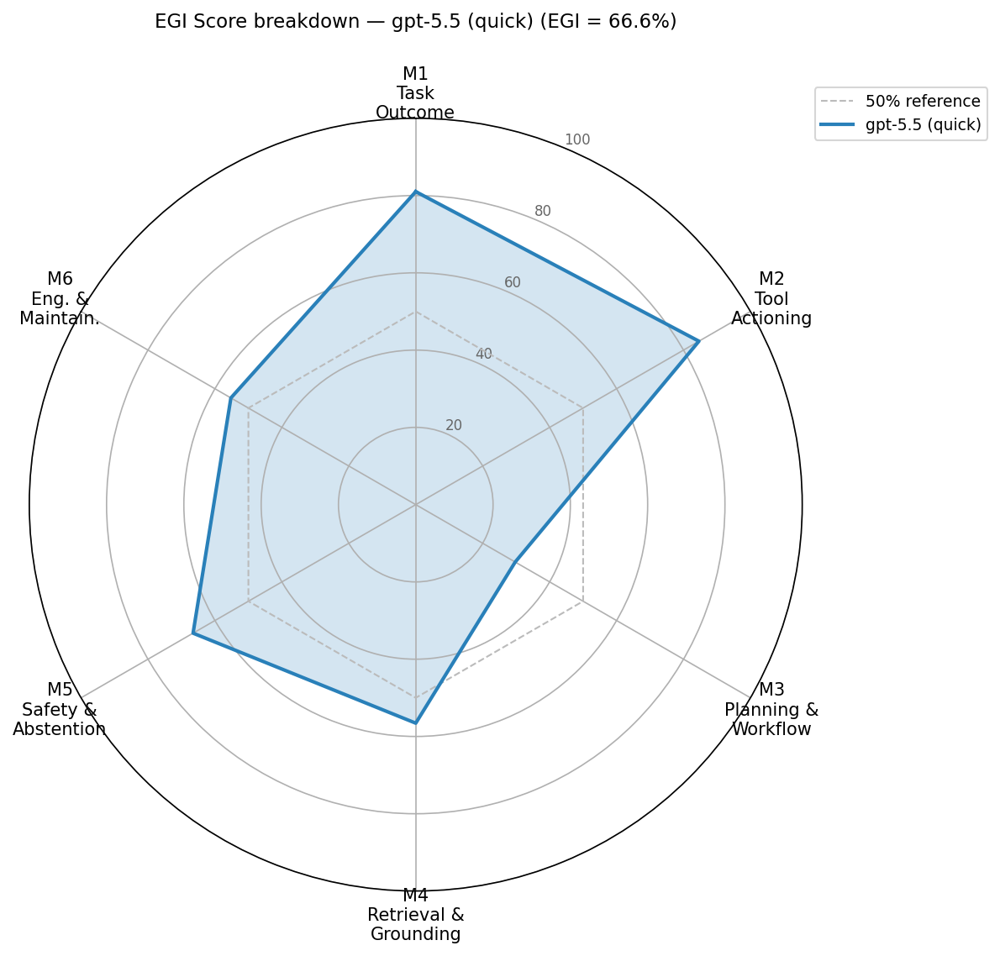
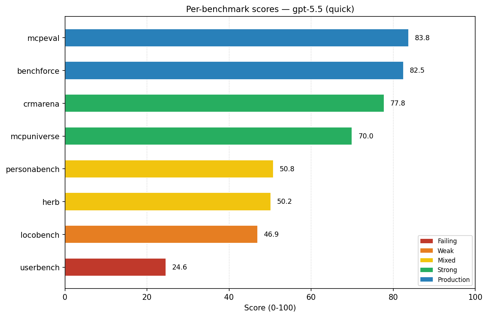
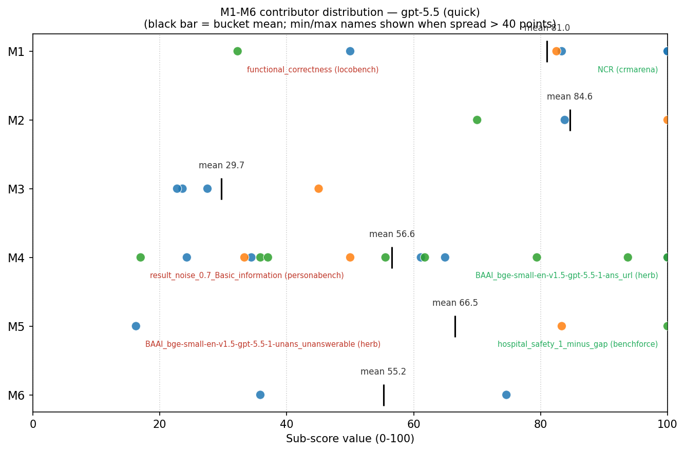

# Example EGI-Bench Analysis Report — gpt-5.5 (quick)

> **What this is.** A real EGI-Bench run on `gpt-5.5` in quick mode, processed end-to-end by the [`egi-bench-analyze-results`](../../.claude/skills/egi-bench-analyze-results/SKILL.md) agent skill. The skill reads the raw aggregate JSON, generates the M1-M6 / per-benchmark / contributor charts, and writes a deployment-readiness write-up grounded in the [scoring routing](../scoring.md). Use this page as a reference for the kind of analysis you can expect from your own run — and as a worked example of how the M-bucket scores translate into concrete enterprise capability statements.
>
> **How it was produced.** From a finished run, invoke the skill in any Cursor / Claude Code session — either type the slash command **`/egi-bench-analyze-results`** (recommended; activates deterministically) or just describe what you want, e.g. *"analyze my latest EGI-Bench report"*.

- **Model:** `gpt-5.5`
- **Mode:** `quick`
- **EGI Score:** **66.6%** (Strong)
- **Run timestamp:** 2026-04-29 04:00:10
- **Total runtime:** 3.55h (12764s)
- **Status:** SUCCESS

> Generated from the raw aggregate JSON on 2026-05-06 by `scripts/build_report.py` (charts via `scripts/render_charts.py`).

## Executive Summary

`gpt-5.5` (quick mode) is **ready to ship today as a structured-task agent on bounded enterprise surfaces** — Salesforce admin and sales-ops automations (CRMArena 77.8%; `NCR/HTU/TII/MTA` all 100%), L1 hospital-coding–style vertical agents (Benchforce 82.5% with `hospital_finished_ratio = 100%`), and multi-step transactional flows on a fixed tool registry (MCPEval Airbnb 83.8%, M2 = 84.6%). It is **not ready** as a multi-turn customer-facing intake bot — UserBench `travel{22,33,44}` collapse identically to 22-28%, meaning the agent loses constraints inside the first 2-3 turns regardless of complexity — nor as an internal-knowledge bot without a strong abstention scaffold (HERB `unans_unanswerable = 16.25%` means the agent fabricates ~84% of the time on out-of-corpus questions). The headline **EGI Score 66.6% (Strong)** is genuine but masks a Failing M3 (29.7%) that defines the boundary between safe single-task deployment and unsafe conversational deployment.

## EGI Score Breakdown

| Metric | Weight | Score | Verdict |
| --- | ---: | ---: | --- |
| **M1. Task Outcome Accuracy** | 28% | 81.0% | Production |
| **M2. Tool Actioning Reliability** | 22% | 84.6% | Production |
| **M3. Planning & Workflow** | 16% | 29.7% | Failing |
| **M4. Retrieval & Evidence Grounding** | 14% | 56.6% | Mixed |
| **M5. Safety, Abstention & Policy** | 14% | 66.5% | Strong |
| **M6. Engineering & Maintainability** | 6% | 55.2% | Mixed |
| **EGI Score** | | **66.6%** | **Strong** |

## Per-Benchmark Scores

| Benchmark | Score | Status | Runtime | Verdict |
| --- | ---: | --- | ---: | --- |
| mcpeval | 83.8% | success | 57.1m | Production |
| benchforce | 82.5% | success | 24.7m | Production |
| crmarena | 77.8% | success | 50.4m | Strong |
| mcpuniverse | 70.0% | success | 9.9m | Strong |
| personabench | 50.8% | success | 56.6m | Mixed |
| herb | 50.2% | success | 1.58h | Mixed |
| locobench | 46.9% | success | 28.3m | Weak |
| userbench | 24.6% | success | 27.8m | Failing |

## Per-Bucket Diagnosis

Every contributor to every M-bucket, sorted from highest to lowest. Wide-spread buckets (>40 points between top and bottom) are flagged — in those cases the bucket mean is a misleading average and the agent should inspect the extremes individually.

### M1. Task Outcome Accuracy — 81.0% (Production, weight 28%)

| Sub-score | Source | Value |
| ---       | ---    | ---:  |
| `NCR` | crmarena | 100.00 |
| `HTU` | crmarena | 100.00 |
| `TII` | crmarena | 100.00 |
| `MTA` | crmarena | 100.00 |
| `BRI` | crmarena | 83.33 |
| `hospital_accuracy_all` | benchforce | 82.50 |
| `TCU` | crmarena | 50.00 |
| `functional_correctness` | locobench | 32.26 |

> **Wide spread (67.7 points).** Top: `NCR` (crmarena, 100.0). Bottom: `functional_correctness` (locobench, 32.3). The bucket mean hides this — diagnose at the contributor level.

### M2. Tool Actioning Reliability — 84.6% (Production, weight 22%)

| Sub-score | Source | Value |
| ---       | ---    | ---:  |
| `hospital_finished_ratio` | benchforce | 100.00 |
| `flex_airbnb` | mcpeval | 83.80 |
| `pass_financial_analysis` | mcpuniverse | 70.00 |

### M3. Planning & Workflow — 29.7% (Failing, weight 16%)

| Sub-score | Source | Value |
| ---       | ---    | ---:  |
| `longcontext_utilization` | locobench | 45.03 |
| `travel22_micro_avg` | userbench | 27.51 |
| `travel33_micro_avg` | userbench | 23.58 |
| `travel44_micro_avg` | userbench | 22.73 |

### M4. Retrieval & Evidence Grounding — 56.6% (Mixed, weight 14%)

| Sub-score | Source | Value |
| ---       | ---    | ---:  |
| `BAAI_bge-small-en-v1.5-gpt-5.5-1-ans_url` | herb | 100.00 |
| `result_noise_0.0_Subjective` | personabench | 100.00 |
| `result_noise_0.7_Subjective` | personabench | 93.75 |
| `result_noise_0.0_Preference` | personabench | 79.41 |
| `BAAI_bge-small-en-v1.5-gpt-5.5-1-ans_pr` | herb | 64.95 |
| `result_noise_0.7_Preference` | personabench | 61.76 |
| `BAAI_bge-small-en-v1.5-gpt-5.5-1-ans_content` | herb | 61.14 |
| `result_noise_0.0_Social` | personabench | 55.56 |
| `NED` | crmarena | 50.00 |
| `result_noise_0.7_Social` | personabench | 37.04 |
| `result_noise_0.0_Basic_information` | personabench | 35.85 |
| `BAAI_bge-small-en-v1.5-gpt-5.5-1-ans_person` | herb | 34.43 |
| `KQA` | crmarena | 33.33 |
| `BAAI_bge-small-en-v1.5-gpt-5.5-1-ans_company` | herb | 24.26 |
| `result_noise_0.7_Basic_information` | personabench | 16.98 |

> **Wide spread (83.0 points).** Top: `BAAI_bge-small-en-v1.5-gpt-5.5-1-ans_url` (herb, 100.0). Bottom: `result_noise_0.7_Basic_information` (personabench, 17.0). The bucket mean hides this — diagnose at the contributor level.

### M5. Safety, Abstention & Policy — 66.5% (Strong, weight 14%)

| Sub-score | Source | Value |
| ---       | ---    | ---:  |
| `hospital_safety_1_minus_gap` | benchforce | 100.00 |
| `PVI` | crmarena | 83.33 |
| `BAAI_bge-small-en-v1.5-gpt-5.5-1-unans_unanswerable` | herb | 16.25 |

> **Wide spread (83.8 points).** Top: `hospital_safety_1_minus_gap` (benchforce, 100.0). Bottom: `BAAI_bge-small-en-v1.5-gpt-5.5-1-unans_unanswerable` (herb, 16.2). The bucket mean hides this — diagnose at the contributor level.

### M6. Engineering & Maintainability — 55.2% (Mixed, weight 6%)

| Sub-score | Source | Value |
| ---       | ---    | ---:  |
| `code_quality` | locobench | 74.61 |
| `software_engineering` | locobench | 35.84 |

## Capability Assessment

**Strengths — what this model can do reliably in enterprise workflows**

- **L1 vertical-domain task agent (hospital coding, claims-style enrichment, HR-ops back-office).** Benchforce `hospital_finished_ratio = 100%` (never abandons mid-loop), `hospital_accuracy_all = 82.5%` (4 of 5 cases coded correctly), and `hospital_safety_1_minus_gap = 100%` (no safety gap between finished and all entries). The combination is the rarest and most enterprise-relevant signal in the report: the agent finishes the work, gets it mostly right, and the wrong cases land as finished-but-wrong (visible to a human reviewer) rather than silently dropped.
- **Salesforce admin / sales-ops co-pilot for structured analytics.** CRMArena `NCR / HTU / TII / MTA = 100%` (case routing, top-issue identification, transfer counting, monthly trend analysis) plus `BRI = 83.3%` (business-rule inference) and `PVI = 83.3%` (PII handling). Safe behind a sales-ops dashboard for first-pass triage, categorization, and trend reporting.
- **Multi-step transactional API agent on a curated tool registry.** MCPEval `flex_airbnb = 83.8%` plus M2 = 84.6% mean tool-call sequencing and argument formation are reliable across multi-step flows. Booking, scheduling, and CRUD against a fixed API surface are deployable today.
- **"Find the link / short factoid" assistant over internal docs.** HERB `ans_url = 100%`, `ans_pr = 64.95%`, `ans_content = 61.14%`. Useful as "where is the design doc for project X?" or "give me the PR that landed feature Y." Limit to URL/short-span retrieval; do *not* extend to named-entity lookups.
- **Subjective / preference summarization on user data, even when noisy.** PersonaBench `Subjective_noise_0.0/0.7 = 100/93.75`, `Preference_noise_0.0 = 79.4`, `Preference_noise_0.7 = 61.8`. The agent answers "what does this user generally prefer?" reliably even with realistic record noise — supports personalization, recommendation rationales, and EA-style preference summaries.

**Weaknesses — workflows this model cannot be trusted with today**

- **Multi-turn customer-facing intake (travel, sales, support, scheduling).** UserBench `travel22 = 27.51%`, `travel33 = 23.58%`, `travel44 = 22.73%` — all three trip-complexity tiers fail equally, meaning the failure happens in the first 2-3 turns regardless of how complex the conversation is. Deploying as a customer-facing booking or intake bot will produce abandoned conversations and *partial transactions* where the agent forgets earlier-stated constraints.
- **Internal-knowledge / FAQ bot covering named entities.** HERB `ans_person = 34.43%`, `ans_company = 24.26%`, `unans_unanswerable = 16.25%`. Two compounded failure modes: (1) the agent fabricates ~84% of the time when the corpus has no answer, and (2) even when an answer exists it cannot reliably ground person/company names. For regulated industries this is a confident-but-wrong knowledge bot — credibility *and* compliance risk.
- **Open-ended customer Q&A from CRM history.** CRMArena `KQA = 33.33%`. When asked an unstructured customer-history question that requires synthesizing case data, the agent returns something usable only one third of the time. Routing/triage works; free-form support replies do not.
- **Executive-assistant-style basic-fact retrieval over noisy private data.** PersonaBench `Basic_information_noise_0.0 = 35.85%` is already weak, drops to `noise_0.7 = 16.98%` — *halves* under realistic record-noise. The agent's "look up this person/contact" capability is unreliable on the messy data shape that actually exists in production CRM and email stores.
- **Autonomous junior-engineer code work.** LoCoBench `functional_correctness = 32.26%`, `software_engineering = 35.84%`, but `code_quality = 74.61%`. The agent writes well-formatted, idiomatic-looking code that fails its tests two thirds of the time — the textbook "looks like a senior engineer, codes like an over-confident intern" failure. Dangerous as an autonomous coding agent (PRs look mergeable, fail in prod); fine as a code-review *suggestion* engine where a human still validates.

## Deployment Recommendations

**Ship now (with these guardrails)**

1. **L1 vertical-domain task agent (hospital coding, claims-style enrichment, HR-ops back-office).** *Why safe:* Benchforce `hospital_accuracy_all = 82.5%` + `hospital_finished_ratio = 100%` + `hospital_safety_1_minus_gap = 100%` mean the agent finishes the job, gets it right ~4/5 of the time, and the wrong cases land as finished-but-wrong (visible) rather than silently dropped. *Required guardrails:* hard-restrict the tool registry to the domain APIs (no escalation to free-form web/LLM tools); human spot-check 20% of completed cases as a queue (since 1-in-5 will be wrong); persist the full chain-of-tool-calls so review is one-click.
2. **Salesforce admin / sales-ops dashboard co-pilot (case routing, transfer counting, top-issue trending, monthly reporting).** *Why safe:* CRMArena `NCR/HTU/TII/MTA = 100%`, `BRI = 83.33%`, `PVI = 83.33%`. *Required guardrails:* enforce a structured-output schema for every analytics question (no free-form prose answers); explicitly route any open-ended customer-history question to a human queue (`KQA = 33.33%` means open-ended Q&A is *not* in scope); keep PII-touching answers behind the same prompt that produced the 83.3% PVI score.
3. **Multi-step transactional agent on a curated tool surface (Airbnb-style booking, internal scheduling, CRUD-on-known-API flows).** *Why safe:* MCPEval `flex_airbnb = 83.8%`, M2 = 84.6%. *Required guardrails:* require a "preview" / dry-run step before any state-changing call (the score is on flex grading; argument-shape errors are not separately measured); confirm parameters back to the user via structured output; restrict to single-session flows — `M3 = 29.7%` means do *not* extend across sessions or many-turn intake before the booking.

**Defer until [scaffold] is in place**

4. **Internal-knowledge / FAQ bot over enterprise docs (engineering wikis, policy docs, runbooks).** *Blocker:* HERB `unans_unanswerable = 16.25%` (fabricates ~84% of the time when no answer exists) plus `ans_person = 34.43%` / `ans_company = 24.26%` (cannot reliably retrieve named entities). *Path to ready (engineering scaffold around the current model — no model upgrade required):* (a) force the model to emit `(answer, source_chunk_id)` pairs and reject any answer without a chunk; (b) gate the response on retriever-confidence — surface a deterministic "No answer found" when retrieval score is below threshold rather than asking the LLM to abstain; (c) until a stronger retriever or a different model lands, *block* questions whose target span is a person or company name (route them to human or to a structured directory lookup). With these scaffolds in place the model's existing `ans_url = 100%` and `ans_content = 61.14%` strengths become safe to expose.

**Do not deploy**

5. **Multi-turn customer-facing intake / booking / support agent without a human in the loop.** *Why:* UserBench `travel22 = 27.51%`, `travel33 = 23.58%`, `travel44 = 22.73%` — equal collapse across all complexity tiers means the agent forgets constraints inside the first 2-3 turns regardless of difficulty. In production this translates to abandoned conversations, partial bookings, and customers being asked the same question twice — visible failure modes that damage brand and CSAT. *Better path:* re-architect as (a) a single-turn slot-filler that captures one constraint per turn and hands to a deterministic state machine, or (b) a one-shot replier that escalates to a human after the first turn. The model is good at *one* well-formed reply (M1 = 81%) but cannot *drive* a sustained conversation; do not put it behind a chat surface that expects multi-turn dialogue.

## Charts

_Embedded from `charts/` next to this file. To regenerate against a different run, point [`build_report.py`](../../.claude/skills/egi-bench-analyze-results/scripts/build_report.py) at a fresh aggregate JSON._

### M1-M6 radar

_M1, M2 push past the Production ring; M5 sits comfortably in Strong; M3 collapses inside the 50% reference circle — the visual signature of a strong single-task agent that cannot drive multi-turn workflows._

### Per-benchmark scores

_The four green/teal bars at the top (mcpeval, benchforce, crmarena, mcpuniverse) define the "ship now" surface; the orange/red tail (locobench, userbench) defines the do-not-deploy boundary. The middle band (personabench, herb at ~50%) is the "defer until scaffold" zone._

### M-bucket contributor distribution

_M4 and M5 each show a near-100-point spread between top and bottom contributors — diagnose at the contributor level, not the bucket mean. M5's bottom point is HERB `unans_unanswerable = 16.25` (the fabrication signature); M4's bottom is PersonaBench `Basic_information_noise_0.7 = 16.98` (the noise-sensitivity signature)._

## Appendix: Per-Benchmark Sub-Scores

Every raw sub-score emitted by every benchmark, exactly as written to the JSON. Use this when a contributor in the diagnosis section needs to be cross-referenced against its source benchmark.

### benchforce — 82.5%

| Sub-score | Value |
| ---       | ---:  |
| `hospital_accuracy_all` | 82.50 |
| `hospital_accuracy_finished` | 82.50 |
| `hospital_all_entries` | 40 |
| `hospital_finished_entries` | 40 |

### crmarena — 77.8%

| Sub-score | Value |
| ---       | ---:  |
| `BRI` | 83.33 |
| `HTU` | 100.00 |
| `KQA` | 33.33 |
| `MTA` | 100.00 |
| `NCR` | 100.00 |
| `NED` | 50.00 |
| `PVI` | 83.33 |
| `TCU` | 50.00 |
| `TII` | 100.00 |

### herb — 50.2%

| Sub-score | Value |
| ---       | ---:  |
| `BAAI_bge-small-en-v1.5-gpt-5.5-1-ans_company` | 24.26 |
| `BAAI_bge-small-en-v1.5-gpt-5.5-1-ans_content` | 61.14 |
| `BAAI_bge-small-en-v1.5-gpt-5.5-1-ans_person` | 34.43 |
| `BAAI_bge-small-en-v1.5-gpt-5.5-1-ans_pr` | 64.95 |
| `BAAI_bge-small-en-v1.5-gpt-5.5-1-ans_url` | 100.00 |
| `BAAI_bge-small-en-v1.5-gpt-5.5-1-unans_unanswerable` | 16.25 |

### locobench — 46.9%

| Sub-score | Value |
| ---       | ---:  |
| `code_quality` | 74.61 |
| `functional_correctness` | 32.26 |
| `longcontext_utilization` | 45.03 |
| `software_engineering` | 35.84 |

### mcpeval — 83.8%

| Sub-score | Value |
| ---       | ---:  |
| `airbnb` | 83.80 |

### mcpuniverse — 70.0%

| Sub-score | Value |
| ---       | ---:  |
| `financial_analysis` | 70.00 |

### personabench — 50.8%

| Sub-score | Value |
| ---       | ---:  |
| `result_noise_0.0_Basic_information` | 35.85 |
| `result_noise_0.0_Preference` | 79.41 |
| `result_noise_0.0_Social` | 55.56 |
| `result_noise_0.0_Subjective` | 100.00 |
| `result_noise_0.7_Basic_information` | 16.98 |
| `result_noise_0.7_Preference` | 61.76 |
| `result_noise_0.7_Social` | 37.04 |
| `result_noise_0.7_Subjective` | 93.75 |

### userbench — 24.6%

| Sub-score | Value |
| ---       | ---:  |
| `travel22_micro_avg` | 27.51 |
| `travel33_micro_avg` | 23.58 |
| `travel44_micro_avg` | 22.73 |

## Appendix: Run Metadata

- **Source report:** `results_aggregated_gpt-5.5/gpt-5.5_quick_20260429_040010.json`
- **Model:** `gpt-5.5`
- **Mode:** `quick`
- **Run kind:** `run` (`run` = fresh execution; `rescore` = re-aggregated from cached outputs)
- **Timestamp:** 2026-04-29 04:00:10
- **Total runtime:** 3.55h (12764s)
- **Degraded:** False
- **Per-benchmark aggregation weights:** benchforce=0.125, crmarena=0.125, herb=0.125, locobench=0.125, mcpeval=0.125, mcpuniverse=0.125, personabench=0.125, userbench=0.125

Routing of every sub-score to its M-bucket is documented in [`docs/scoring.md`](../scoring.md) at the repo root.
