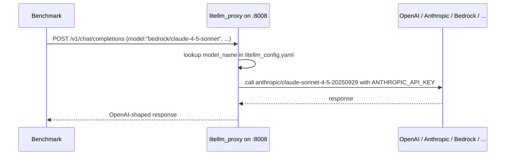

# LLM Providers

EGI-Bench routes every benchmark's LLM call through a local
[**LiteLLM Proxy**](../litellm_proxy/README.md) on
`http://localhost:8008/v1`. The proxy translates the OpenAI wire
protocol the benchmarks already speak into per-provider formats —
Anthropic message envelopes, Bedrock SigV4 signing, Gemini structured
tools, and so on — so adding a new provider almost always means
adding one entry to [`litellm_proxy/litellm_config.yaml`](../litellm_proxy/litellm_config.yaml)
and one credential to `.env`.

This page covers:

- [How `--model` resolves to a provider](#how---model-resolves-to-a-provider)
- [Adding a provider](#adding-a-provider)
- [Provider recipes](#provider-recipes)
- [Judge / simulator pinning](#judge--simulator-pinning)
- [Reasoning-family parameter handling](#reasoning-family-parameter-handling)

## How `--model` resolves to a provider

`egi-bench run --model X` is just the OpenAI request body's `model`
field. Each benchmark sends it to `localhost:8008/v1/chat/completions`,
LiteLLM Proxy looks up `X` in `model_list[*].model_name`, and the
matching `litellm_params` block tells LiteLLM which provider to call,
which credential to use, and (optionally) which extra headers to send.



## Adding a provider

1. Pick a friendly `model_name` users will pass to `egi-bench run --model`.
2. Add a `model_list` entry to
   [`litellm_proxy/litellm_config.yaml`](../litellm_proxy/litellm_config.yaml).
   `litellm_params.model` always uses `provider/upstream_id` syntax.
   See [LiteLLM's provider matrix](https://docs.litellm.ai/docs/providers)
   for the full list of supported prefixes.
3. Set the relevant credential in `.env` (e.g. `ANTHROPIC_API_KEY`,
   `GEMINI_API_KEY`, `VERTEX_PROJECT`, `AWS_ACCESS_KEY_ID`, ...).
4. Restart the proxy: `cd litellm_proxy && bash start_server.sh`.
5. Verify: `curl localhost:8008/v1/models | jq '[.data[].id]'` should
   list the new `model_name`.

## Provider recipes

### OpenAI direct

Default. `litellm_settings.drop_params: true` (already on) handles the
reasoning-family parameter quirks for `gpt-5*`, `o1*`, `o3*`, `o4*`.

```yaml
- model_name: gpt-5
  litellm_params:
    model: openai/gpt-5
    api_key: os.environ/OPENAI_API_KEY
```

### Anthropic direct

LiteLLM translates the OpenAI message format to Anthropic's `messages`
+ `system` shape automatically.

```yaml
- model_name: claude-sonnet-4-5
  litellm_params:
    model: anthropic/claude-sonnet-4-5-20250929
    api_key: os.environ/ANTHROPIC_API_KEY
```

### Google Gemini direct

```yaml
- model_name: gemini-2.5-pro
  litellm_params:
    model: gemini/gemini-2.5-pro
    api_key: os.environ/GEMINI_API_KEY
```

### Google Vertex AI

Use Vertex AI when you want Gemini served from a Google Cloud project
rather than the public Gemini API. LiteLLM uses Application Default
Credentials (`gcloud auth application-default login`) or the service
account referenced by `GOOGLE_APPLICATION_CREDENTIALS`.

```yaml
- model_name: vertex/gemini-2.5-pro
  litellm_params:
    model: vertex_ai/gemini-2.5-pro
    vertex_project: os.environ/VERTEX_PROJECT
    vertex_location: os.environ/VERTEX_LOCATION
```

### AWS Bedrock

LiteLLM signs requests with SigV4 using the standard AWS env vars
(`AWS_ACCESS_KEY_ID`, `AWS_SECRET_ACCESS_KEY`, `AWS_REGION`) — or you
can pass them explicitly per route. Each Bedrock model identifier is
the standard AWS string.

```yaml
- model_name: bedrock/claude-4-5-sonnet
  litellm_params:
    model: bedrock/us.anthropic.claude-sonnet-4-5-20250929-v1:0
    aws_region_name: os.environ/AWS_REGION
    # Optional explicit creds; otherwise uses the default boto3 chain.
    # aws_access_key_id: os.environ/AWS_ACCESS_KEY_ID
    # aws_secret_access_key: os.environ/AWS_SECRET_ACCESS_KEY
```

### OpenRouter

```yaml
- model_name: openrouter-llama-3.1-405b
  litellm_params:
    model: openrouter/meta-llama/llama-3.1-405b-instruct
    api_key: os.environ/OPENROUTER_API_KEY
```

### Self-hosted (vLLM, Ollama, TGI)

Use the `openai/` provider prefix and point `api_base` at your local
server. Most self-hosted servers ignore the bearer header.

```yaml
- model_name: local-llama
  litellm_params:
    model: openai/llama-3.1-70b-instruct
    api_base: http://localhost:11434/v1     # Ollama example
    api_key: any-non-empty-string
```

## Judge / simulator pinning

Five benchmarks issue calls to hardcoded model names as part of
scoring — judges, user simulators, and evaluator clients that the user
does not choose via `--model`. For EGI scores to stay apple-to-apple
across runs, those calls must always resolve to the same provider
regardless of which model is under test.

| Benchmark | Fixed call | Default model | Source |
|---|---|---|---|
| HERB | `get_gpt4_response` (judge for `gpt4-correctness` and metadata helpers) | `gpt-4o` | [`HERB/code/utils.py`](../HERB/code/utils.py) |
| HERB | `OpenAIEmbedding` — **dormant in EGI-Bench's pipeline.** `run_all.py` always passes `--embedding_mode huggingface --embedding_model_name BAAI/bge-small-en-v1.5` (from `benchmark_config.yaml` → `benchmarks.herb.default_args`), so the index is built locally via `HuggingFaceEmbedding` / SentenceTransformer with no network call. The OpenAI branch fires only when HERB is invoked directly (outside EGI-Bench) with `--embedding_mode openai`. | `text-embedding-3-large` | [`HERB/code/react.py`](../HERB/code/react.py) |
| MCP-Universe | `google_search__call_gpt` (`google_search.llm_as_a_judge`) | `gpt-4.1` (override via `EVALUATOR_MODEL`) | [`MCP-Universe/mcpuniverse/evaluator/google_search/functions.py`](../MCP-Universe/mcpuniverse/evaluator/google_search/functions.py) |
| MCP-Universe | `deepresearch__call_gpt_hle` (`deepresearch.hle_llm_as_a_judge`) | `o3-mini-2025-01-31` | [`MCP-Universe/mcpuniverse/evaluator/deepresearch/functions.py`](../MCP-Universe/mcpuniverse/evaluator/deepresearch/functions.py) |
| UserBench | TravelGym simulator (`TravelGymConfig.model_name`) | `gpt-4o` | [`UserBench/travelgym/config.py`](../UserBench/travelgym/config.py) |
| CRMArena | `Evaluator` answer-parser + privacy-rejection judge (LiteLLM client, `provider="openai"`) — dormant under EGI-Bench's default `agent_strategy: tool_call`; fires only when the strategy is flipped to `react` / `act`, which constructs `ChatEnv` / `InteractiveChatEnv` | `gpt-4o-2024-08-06` | [`CRMArena/crm_sandbox/env/env.py`](../CRMArena/crm_sandbox/env/env.py) |
| BenchForce | User simulator (`OpenAIText` / `OpenAIRealtime` / TTS-clean helper) | `gpt-4o` (text), `gpt-4o-realtime-preview` (realtime), `gpt-4o-mini` (clean) | [`Benchforce/src/classes/providers/openai.py`](../Benchforce/src/classes/providers/openai.py), [`Benchforce/src/classes/parser.py`](../Benchforce/src/classes/parser.py) |

Each benchmark subprocess receives `OPENAI_BASE_URL=http://localhost:8008/v1`
and `OPENAI_API_KEY=dummy` from `run_all.py`, so every call above lands
on the local LiteLLM proxy. The shipped
[`litellm_proxy/litellm_config.yaml`](../litellm_proxy/litellm_config.yaml)
**pins** the judge / simulator `model_name`s to OpenAI direct so they
always resolve to `api.openai.com` even when
`egi-bench run --model claude-sonnet-4-5` is in flight. Currently pinned:

- Chat: `gpt-4`, `gpt-4-turbo`, `gpt-4o`, `gpt-4o-mini`,
  `gpt-4o-2024-08-06`, `gpt-4.1`, `gpt-4.1-mini`, `gpt-4.1-nano`,
  `o3-mini-2025-01-31`.
- Embeddings: `text-embedding-3-large`, `text-embedding-3-small`.

This covers every model name in the table above that's actually wired
up to flow through the proxy. Four notes on the embedding pins, the
CRMArena evaluator, and the BenchForce realtime models:

- **`text-embedding-3-large`** has no caller during a default
  EGI-Bench run. HERB is the only benchmark whose framework code can
  request it (via `OpenAIEmbedding`), and `run_all.py` overrides
  HERB's argparse default (`text-embedding-3-large`) with
  `--embedding_mode huggingface --embedding_model_name BAAI/bge-small-en-v1.5`
  on every invocation — so HERB takes the
  `HuggingFaceEmbedding(model_name="BAAI/bge-small-en-v1.5")` branch
  in [`HERB/code/react.py`](../HERB/code/react.py) and runs
  SentenceTransformer locally. The pin exists to keep HERB on OpenAI
  direct *if* a caller invokes
  `python rag.py ... --embedding_mode openai` outside the EGI-Bench
  runner (e.g. when reproducing the upstream HERB paper, where
  `text-embedding-3-large` is the canonical default).
- **`text-embedding-3-small`** has no framework-side caller in
  EGI-Bench at all. It is pinned defensively for two reasons. First,
  MCP-Universe's `postgres/vectors` task seeds an `embedding_models`
  fixture table whose rows include `text-embedding-3-small` (see
  [`MCP-Universe/mcpuniverse/evaluator/mcpmark/postgres/vectors/vectors_setup.py`](../MCP-Universe/mcpuniverse/evaluator/mcpmark/postgres/vectors/vectors_setup.py));
  the stored vectors themselves are mock-generated locally, but a
  model under test with tool access can decide to call the real
  OpenAI embedding endpoint to compute query vectors as part of
  solving the task. Second, future benchmarks may default to the
  cheaper `-3-small` model. In both cases the pin keeps any such call
  on OpenAI direct rather than routing through whichever provider
  happens to be configured for the model under test.
- **CRMArena evaluator** (`gpt-4o-2024-08-06`) is dormant under the
  shipped configuration. `benchmark_config.yaml` pins
  `default_args.agent_strategy: tool_call` for both quick and deep,
  which routes `CRMArena/run_tasks.py` to `ToolEnv`. `ToolEnv.calculate_reward`
  scores answers with pure lexical metrics (`em` / `f1` / `bleu` /
  `rouge` via `crm_sandbox/agents/utils.py:get_all_metrics`) and never
  constructs the `Evaluator`. The `Evaluator` (and therefore the
  `gpt-4o-2024-08-06` call) only runs if you flip the strategy to
  `react` or `act`, which constructs `ChatEnv` / `InteractiveChatEnv`
  and hits `litellm.completion(model="gpt-4o-2024-08-06",
  custom_llm_provider="openai", ...)` for answer parsing and the
  privacy-rejection check. The `gpt-4o-2024-08-06` proxy entry, plus
  the `OPENAI_BASE_URL` / `OPENAI_API_KEY=dummy` overrides
  `run_all.py:run_crmarena` injects, exist to keep that path pinned to
  the rest of the judge stack if anyone re-enables it.
- **BenchForce realtime / TTS-clean** (`gpt-4o-realtime-preview`,
  `gpt-4o-mini`) only fire in audio mode. EGI-Bench's
  `Benchforce/run_benchforce.py` wrapper hardcodes `agent_mode: text`
  with `agent_realtime_model=""` and `client_realtime_model=""`, so
  those code paths never execute. The realtime path is also
  inherently unroutable through this proxy — OpenAI's realtime API is
  a WebSocket (`wss://api.openai.com/v1/realtime`) and the LiteLLM
  Proxy only exposes HTTP `/v1/chat/completions`, `/v1/embeddings`, and
  related REST surfaces. If you re-enable realtime, expect the
  WebSocket call to bypass the proxy entirely.

This is why `OPENAI_API_KEY` is required even when the tested model is
non-OpenAI.

## Reasoning-family parameter handling

`gpt-5*`, `o1*`, `o3*`, `o4*` reject the legacy `temperature`,
`top_p`, and `max_tokens` parameters and require
`max_completion_tokens` instead. LiteLLM strips the unsupported
parameters automatically when `litellm_settings.drop_params: true`
is set (default in the shipped config).

If a specific reasoning model returns empty completions because the
benchmark's default budget is too small, set a per-route floor:

```yaml
- model_name: gpt-5-nano
  litellm_params:
    model: openai/gpt-5-nano
    api_key: os.environ/OPENAI_API_KEY
    max_completion_tokens: 4096
```

> **Cross-cutting reasoning detection.** EGI-Bench separately maintains
> a small registry of model-name patterns (OpenAI o-series + GPT-5*,
> Gemini 2.5 / 3, Claude 3.7 + 4.x, DeepSeek-R1) so each benchmark's
> wrapper can pre-bump its own `max_tokens` cap *before* the call hits
> LiteLLM. This complements `drop_params` (which fixes the *parameter
> name*) by also fixing the *budget*, so reasoning-class models don't
> exhaust their allowance on hidden thinking tokens. To add a new
> family to that registry, follow the
> [reasoning-model registry runbook](./reasoning-models.md).
